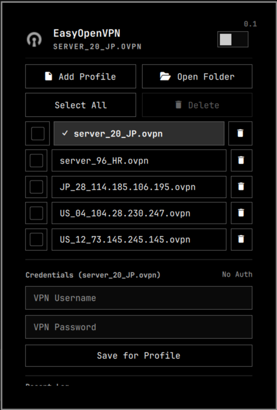

# EasyOpenVPN

<p align="center">
  
</p>

EasyOpenVPN is a lightweight, secure Omarchy bar widget for managing and running OpenVPN connections directly from the Omarchy desktop shell. It provides a compact status icon, a full-featured profile manager, saved credentials, connect/disconnect controls, automatic kill-switch protection, live tunnel details, and recent OpenVPN log output.

The plugin is intentionally focused: it does not require NetworkManager VPN plugins or systemd services. It is built for users who already have `.ovpn` or `.conf` files and want a streamlined, theme-aware bar widget with reliable connection status and instant leak protection.

---

## Features

- **Profile Management**:
  - Add `.ovpn` or `.conf` configuration files with a graphical file picker (**Add Profile**).
  - Open the configuration directory in your file manager (**Open Folder**).
  - **Drag-and-Drop Reordering**: Press and hold any profile to drag and reorder; custom order is automatically saved across restarts.
  - **Multi-Selection & Batch Delete**: Select individual profiles with checkboxes or click **Select All**, then remove them with **Delete**.
  - **Quick Single-Profile Delete**: Per-profile trash icon with two-step click-to-confirm safety.
  - Profiles and settings persist across restarts under `~/.local/state`.

- **Profile-Specific Credentials**:
  - Store VPN username and password per configuration file (**Save for Profile**).
  - Credentials automatically switch when selecting different profiles.
  - Credentials files are stored with restricted private permissions.

- **Accurate Connection State**:
  - Distinguishes between **Connecting…** (during TLS handshake) and **Connected**.
  - Only transitions to **Connected** once OpenVPN logs `Initialization Sequence Completed` and the tunnel device receives an IPv4 address.
  - Automatic connection timeout: aborts attempts taking longer than 9 seconds without tripping the kill switch.
  - Cancel pending connections at any time with a single click.

- **Integrated Kill Switch**:
  - Privileged background guard monitors the OpenVPN process, the tunnel device, and runtime logs.
  - If an established VPN connection drops unexpectedly, it instantly deploys an isolated `nftables` table (`inet simpleopenvpn`) dropping all non-loopback network traffic to prevent IP or DNS leaks.
  - In-panel alert: **Kill switch • network blocked**, reporting the failure reason and providing a **Restore Network** button.
  - Unblocking only happens by explicit user action; network is never silently restored behind the scenes.

- **Optional Passwordless Mode**:
  - Run the included one-time setup (`sudo ./setup-passwordless.sh`) to authorize a locked-down control script via Polkit.
  - Replaces system password dialogs with a quick in-panel confirmation card.

- **Live Diagnostics & Theming**:
  - View active tunnel interface name, assigned IPv4 address, and real-time traffic statistics.
  - Embedded monospace log view showing recent OpenVPN output directly in the panel.
  - Themed OpenVPN icon in both the status bar and panel, automatically matching your active Omarchy theme colors.

---

## Requirements

EasyOpenVPN is designed for Omarchy and its Quickshell-based desktop shell.

Install the required packages before enabling the plugin:

```sh
omarchy pkg add openvpn jq zenity python nftables
```

The plugin also uses standard command-line tools included with Omarchy and Arch Linux:
- `pkexec`
- `ip` (iproute2)
- `nft` (nftables, required for the kill switch)
- `ps`, `find`, `awk`, `grep`, `sed`
- `python3`
- GNU coreutils

---

## Installation

### Via Omarchy Plugin Manager

Install dependencies:

```sh
omarchy pkg add openvpn jq zenity python nftables
```

Add and enable the plugin:

```sh
omarchy plugin add https://github.com/kanpianer/EasyOpenVPN.git --enable
```

Place the widget in the desired bar section (e.g. right side):

```sh
omarchy bar move io.github.kanpianer.easy-openvpn --section right
```

### From Local Source

You can also install from a local checkout:

```sh
./install.sh
```

---

## Usage

1. **Open the Panel**: Click the EasyOpenVPN icon in the Omarchy status bar.
2. **Add Profiles**: Click **Add Profile** to select one or more `.ovpn` or `.conf` files. Click **Open Folder** to view or manage them in your file manager.
3. **Reorder Profiles**: Long-press (press and hold) a profile row and drag it to your preferred position in the list.
4. **Manage Profiles**: Use the checkboxes to select profiles and click **Delete** (or click the individual trash icon) to remove profiles.
5. **Set Credentials**: If your VPN requires authentication, enter your username and password, then click **Save for Profile**.
6. **Connect**: Toggle the switch in the panel header. A confirmation card will appear. Confirm to establish the connection.
7. **Quick Control**: Right-clicking the bar icon disconnects immediately. If passwordless mode is active, right-clicking opens the confirmation card for quick connection.

---

## Passwordless Connect (Optional)

By default, connecting uses `pkexec`, prompting for your account password via the Omarchy Polkit dialog. To replace this prompt with the streamlined in-panel confirmation card, run the one-time helper script in a terminal:

```sh
sudo ./setup-passwordless.sh
```

The script installs a root-owned copy of the control script under `/usr/local/lib/simpleopenvpn` and a narrow Polkit rule authorizing **only** that exact program for `connect` and `disconnect`. The rule does not permit running arbitrary commands as root.

To remove the passwordless rule at any time:

```sh
sudo ./setup-passwordless.sh --remove
```

---

## Connection State & Kill Switch

### Handshake & Timeout

The bar and panel only display **Connected** after OpenVPN completes its TLS handshake (`Initialization Sequence Completed`) and the virtual interface has an IPv4 address. If the handshake does not complete within 9 seconds (e.g., unreachable server or wrong credentials), the attempt is aborted and the network remains untouched.

### Kill Switch Protection

When a connection is established, a privileged watchdog monitors the tunnel. If the server drops the connection, the tunnel interface is deleted, or the OpenVPN process dies unexpectedly, the guard:

1. Installs a dedicated `nftables` table (`inet simpleopenvpn`) that drops all incoming, outgoing, and forwarded traffic except loopback (`lo`).
2. Terminates OpenVPN.
3. Notifies the user with a **Kill switch • network blocked** status and displays a **Restore Network** button.

The firewall rules are removed only when the user explicitly clicks **Restore Network**, turns off the switch, or disconnects from the bar icon.

---

## Security Model

EasyOpenVPN is designed following security hardening practices:

- **Unprivileged Desktop Host**: The UI and state management run inside the desktop user's Quickshell session. Privileged actions are delegated strictly through `pkexec` or the optional locked Polkit helper.
- **Credential Safety**: VPN credentials are never passed via process command-line arguments (`argv`). Instead, private descriptor-relative mechanisms and strict file permissions (`0600`) are used.
- **Path & Directive Hardening**: OpenVPN profiles are inspected with `O_NOFOLLOW` checks. Dangerous directives that could trigger arbitrary code execution or hook into system processes (such as `plugin`, nested `config`, `iproute`, management sockets, and custom script hooks) are rejected.
- **Firewall Isolation**: The kill switch uses an independent `inet simpleopenvpn` nftables table. Existing system firewall configurations (e.g., UFW) are left untouched.

---

## Removal

To disable and remove the plugin from Omarchy:

```sh
omarchy plugin remove io.github.kanpianer.easy-openvpn
```

If you configured the optional passwordless helper, remove it with:

```sh
sudo ./setup-passwordless.sh --remove
```

---

## Marketplace Metadata

For reference when submitting to the [Omarchy Plugin Marketplace](https://plugins.omarchy.org/):

- **ID**: `io.github.kanpianer.easy-openvpn`
- **Repository**: `https://github.com/kanpianer/EasyOpenVPN`
- **Category**: `Widgets`
- **Tags**: `vpn`, `bar`, `security`
- **Preview Asset**: `preview.png`

---

## Credits & Acknowledgments

- **Original Author**: [Diogo Carvalho](https://github.com/diogogc) ([diogogc/simple-openvpn](https://github.com/diogogc/simple-openvpn)) for creating SimpleOpenVPN and providing its solid foundation.
- **Security Hardening**: Security review and hardening recommendations provided by [HANCORE-linux](https://github.com/HANCORE-linux).

---

## License

This project is licensed under the [MIT License](LICENSE).
